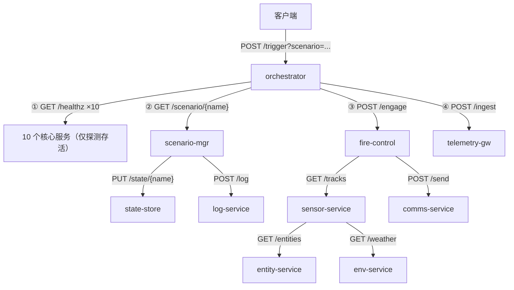
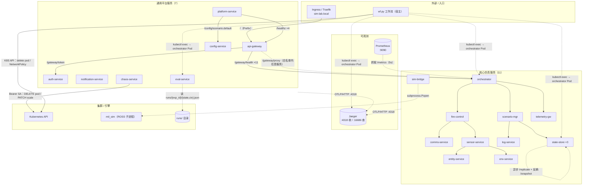
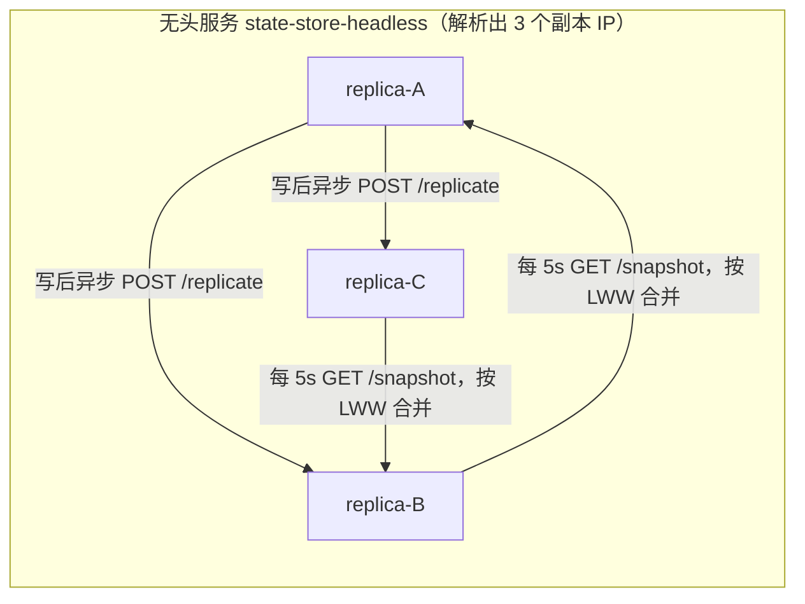
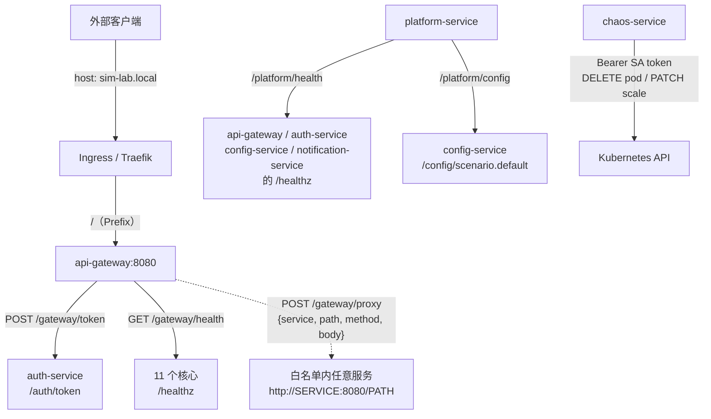
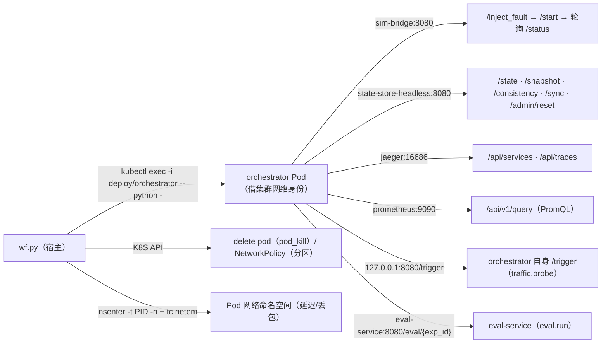

# 服务接口与调用关系

> **本文定位**：把 18 个微服务当作一个"服务集群"来看——**每个服务承担什么业务、对外暴露哪些 HTTP 接口（方法/路径/入参/出参）、服务之间用什么协议通信、谁调用谁、一次请求如何穿过整个集群**。
>
> 与其它文档的分工：
> - `README.md`：项目总览 + 快速上手（命令级）。
> - `docs/ARCHITECTURE.md`：分层架构 + 一次实验的执行路径（"纵向"流程）。
> - `docs/代码说明手册.md`：目录地图 + 模块职责（"代码长什么样"）。
> - **本文**：服务接口契约 + 通信协议 + 调用关系（"横向"——服务与服务之间如何咬合）。
>
> 所有接口、字段、协议均来自 `services/*/app.py`、`services/common/`、`actions/` 的真实代码，非示意。连接图用 Mermaid 绘制（GitHub / 多数 Markdown 渲染器可直接出图）。

---

## 1. 服务总览（业务地图）

18 个 FastAPI 服务部署在 K3S 命名空间 `sim-test`，分两类：

- **11 个核心仿真服务**：还原一条"营级作战仿真"业务链路（想定 → 火控 → 传感器/通信 → 遥测），外加 ROSS 离散事件仿真桥接与可复制状态存储。
- **7 个通用平台服务**：网关、认证、配置、通知、平台身份、混沌工程、结果评估——与业务无关，可被任意实验复用。

| 服务 | 类别 | 一句话业务定位 | 是否有下游 |
| --- | --- | --- | --- |
| `orchestrator` | 核心 | 业务编排入口，`POST /trigger` 串起整条作战链路 | 10 个核心服务 |
| `scenario-mgr` | 核心 | 想定加载（营攻击/空防/合同作战） | state-store、log-service |
| `entity-service` | 核心 | 作战实体/单位清单 | 无（叶子） |
| `comms-service` | 核心 | 通信指令下发 | 无（叶子） |
| `sensor-service` | 核心 | 目标航迹/情报融合 | entity-service、env-service |
| `fire-control` | 核心 | 火控交战（P0 核心，独立配额） | sensor-service、comms-service |
| `env-service` | 核心 | 地形气象参数 | 无（叶子） |
| `log-service` | 核心 | 事件留痕（非核心，可降级） | 无（叶子） |
| `state-store` | 核心 | 可复制状态存储（3 副本，一致性实验对象） | 副本之间反熵 |
| `telemetry-gw` | 核心 | 遥测数据落库 | 无（叶子） |
| `sim-bridge` | 核心 | ROSS 仿真引擎桥接（真实 `mil_sim`） | mil_sim 子进程 |
| `api-gateway` | 平台 | 统一入口、健康聚合、受限反向代理 | auth-service + 任意白名单服务 |
| `auth-service` | 平台 | HMAC-SHA256 无状态令牌签发/校验 | 无（叶子） |
| `config-service` | 平台 | 版本化配置中心 + 变更历史 | 无（叶子） |
| `notification-service` | 平台 | 分级通知缓存与统计 | 无（叶子） |
| `platform-service` | 平台 | 节点/Pod 身份、cgroup 限额、平台组件健康 | 4 个平台服务 |
| `chaos-service` | 平台 | 集群内 Pod kill / Deployment 伸缩（RBAC） | K8S API |
| `eval-service` | 平台 | 读 `runs/<exp_id>/` 产出感知/容错/一致性/追踪四类评分 + 等级 | 读挂载的 runs 目录（不跨服务） |

### 1.1 寻址与端口约定

- **端口**：全部 18 个服务统一监听 `8080`（见 `manifests/services.yaml`，`port: 8080 / targetPort: 8080`）。
- **服务发现**：集群内用 K8S Service DNS 直接按服务名寻址，形如 `http://fire-control:8080/engage`。无独立注册中心。
- **例外**：`state-store` 额外暴露一个**无头 Service** `state-store-headless`（`clusterIP: None, publishNotReadyAddresses: true`），把 3 个副本 IP 直接解析出来——这是"定向写单个副本制造分叉 / 逐副本读快照"的前提。
- **外部入口**：Ingress（Traefik，`ingressClassName: traefik`）把 host `sim-lab.local` 的 `/` 前缀路由到 `api-gateway:8080`（见 `manifests/platform-ingress.yaml`）。集群外不直连业务服务，一律经网关。

---

## 2. 通信底座与协议

### 2.1 统一契约（所有服务共享）

每个服务都由 `services/common/base.py` 的 `create_app()` 工厂构建，**自动**获得 4 个标准端点（无需各服务自行实现）：

| 方法/路径 | 作用 | 出参 |
| --- | --- | --- |
| `GET /healthz` | 存活探针（K8S liveness） | `{"status":"ok","service":"<name>","uptime":<s>}` |
| `GET /readyz/business` | 业务就绪探针（readiness） | `{"status":"ready","service":"<name>","business":"ok","deps":[]}` |
| `GET /metrics` | Prometheus 指标（挂载 `make_asgi_app`） | Prometheus 文本 exposition 格式 |
| `GET /tracez` | 追踪自检（导出队列/已发/失败 span 数） | `tracing.stats()` 字典 |

约定：

- **指标命名**：Prometheus 指标名只允许字母/数字/下划线/冒号，服务名中的 `-` 会被规范成 `_`（如 `fire_control_requests_total`、`fire_control_health`）。
- **跳过追踪**：`/metrics` 与 `/tracez` **不生成 span**（见 `tracing.TracingMiddleware._SKIP_PATHS`），否则 Prometheus 每 5s 的抓取会刷出海量"单 span 根 trace"，把业务链路挤出采样窗口。

### 2.2 服务间同步调用协议（核心）

服务之间的**同步 HTTP 调用**统一走 `services/common/tracing.py` 的 `traced_json_request(method, url, body, timeout, span_name)`。这是整个集群"协议层"的核心，规则如下：

1. **传输**：HTTP + JSON。`body` 非空时自动加 `Content-Type: application/json`；总是带 `Accept: application/json`。
2. **服务发现**：`url` 用 K8S Service DNS（`http://<service>:8080/<path>`）。
3. **链路传播**：自动从当前 SERVER span 派生 `traceparent`（W3C Trace Context，`00-<32hex>-<16hex>-01`）注入请求头，把一次跨服务调用串成一条 trace。
4. **CLIENT span**：每次调用开一个 CLIENT span，打 `http.url` / `http.method` / `http.status_code` / `peer.service`（被调方服务名）标签。
5. **失败语义（关键）**：**下游失败不抛异常**。连接失败/超时 → 返回 `(0, {"error": ...})`；HTTP ≥500 → span 标 error 但正常返回；HTTP 2xx 但 body 非 JSON → 返回文本。调用方据此**自行决定降级**（这正是"容错"研究要观察的行为）。
6. **超时**：每次调用显式传 `timeout`（默认 3.0s，各调用点 1.5~4s 不等），用 `urllib` 实现，失败即按第 5 条处理。

> 一句话：**集群内服务间通信 = HTTP/JSON over K8S DNS + W3C traceparent 传播 + "失败降级不抛异常"语义。**

### 2.3 跨服务分布式追踪协议

追踪底座同样是纯标准库（无 opentelemetry 依赖），实现三件事：

- **W3C Trace Context**：`parse_traceparent` / `format_traceparent` 解析与注入 `traceparent` 头。
- **SERVER span**：ASGI 中间件为每个入站请求（除 `/metrics`、`/tracez`）生成 SERVER span，记录状态码、耗时、错误。
- **CLIENT span**：`traced_json_request` 为每次下游调用生成 CLIENT span。
- **导出**：span 入有界队列（默认 4096），后台线程**批量**（≤256/批）**POST OTLP/HTTP JSON** 到 `OTLP_ENDPOINT`（默认 `http://jaeger:4318/v1/traces`）。失败只计数、绝不阻塞业务。

关键标签（故障定位依赖它们）：

| 标签 | 含义 |
| --- | --- |
| `peer.service` | 被调方服务名（客户端 span）——失败时直接指认"谁挂了" |
| `http.status_code` | 下游返回码（0 = 连接失败/超时） |
| `http.url` / `http.method` | 调用目标 |
| `error` | span 失败标记 |

### 2.4 指标采集协议

- 每个服务暴露 `GET /metrics`（Prometheus exposition 文本）。
- `manifests/prometheus.yaml` 的 Prometheus 每 **5s** 抓取所有 `*_requests_total`、`*_health`、`*_business_ready`、`*_uptime_seconds`。
- 工作流侧（`actions/obs.py`）通过 `kubectl exec` 进 orchestrator Pod 查 `http://prometheus:9090/api/v1/query`（PromQL），单次批量按 `instance` 分组取各服务请求率。

### 2.5 专用协议（超出普通 HTTP/JSON 的）

| 机制 | 协议/细节 | 位置 |
| --- | --- | --- |
| **state-store 异步复制** | 写入后开线程对每个 peer `POST /replicate`（单条 entry），失败只计数（AP 倾向，不影响本地写） | `state-store/app.py::_push_to_peers` |
| **state-store 反熵** | 后台线程每 `ANTI_ENTROPY_INTERVAL`（默认 5s）对每个 peer `GET /snapshot`，按 **LWW** 合并：比较 `(version, updated_at, origin)` 字典序 | `state-store/app.py::_anti_entropy_loop` |
| **state-store 副本发现** | 优先 `PEERS` 环境变量；否则解析无头服务 `state-store-headless` 的全部 A 记录，剔除自身 | `state-store/app.py::discover_peers` |
| **ROSS 仿真驱动** | sim-bridge 用 `subprocess.Popen` 起 `mil_sim --synch=1 --end=<t> --units=<n>`（顺序同步），**故障经环境变量** `ROSS_FAULT_TYPE/TARGET/AT` 注入 C 侧；结束时解析日志回退出码与统计 | `sim-bridge/app.py` |
| **认证令牌** | 无状态令牌 `payload.signature`，`signature = b64(HMAC-SHA256(AUTH_SECRET, payload))`；payload 含 `sub/role/iat/exp/jti`；任意副本可用同一密钥校验 | `auth-service/app.py` |
| **混沌编排** | chaos-service 用 in-cluster ServiceAccount `sim-chaos`（`Bearer` token + `ca.crt`）直连 K8S API（`https://kubernetes.default.svc`），`PATCH .../scale` 用 `application/merge-patch+json` | `chaos-service/app.py` |
| **结果评估** | eval-service 直接读 `runs/<exp_id>/{state,ctx}.json`（`RUNS_DIR`=`/runs`，hostPath 只读挂载自 `/mnt/hgfs/code/sim_lab/runs`），不跨服务调用，算出四维评分 + A~D 等级 | `eval-service/app.py` |

> **什么是"反熵"（anti-entropy）？** 异步复制"传得快"，但网络丢包/分区会让某些副本漏掉更新，各副本状态随之**各自漂移**——这种不一致就是"熵"，放任不管会越来越多（副本分叉）。**反熵**就是后台周期性"对账 + LWW 合并"：拉每个 peer 的全量快照，按版本戳确定性合并，把分叉的副本**自动收敛回一致**。两者是快慢两条路——异步复制是**快路径**（多数情况实时送达），反熵是**修复路径**（漏掉的补回来，是最终一致性的保证）。`GET /consistency` 即"熵表"，报当前是否一致、哪些 key 分叉；`POST /repair` 可手动触发一次反熵。

---

## 3. 接口参考（逐服务）

> 下表只列**业务端点**（2.1 的 4 个标准端点 + 各服务的 `GET /` 不再重复）。"下游"指该接口处理过程中会真实调用的其它服务。

### 3.1 核心仿真服务

#### orchestrator（业务编排入口）

| 方法/路径 | 入参 | 出参 | 下游调用 |
| --- | --- | --- | --- |
| `POST /trigger` | query `scenario`（默认 `battalion_attack`） | `{scenario, trace_id, health{10 个服务}, scenario_data, engage, telemetry_status}` | ①对 10 个核心服务 `GET /healthz`；②`GET scenario-mgr/scenario/{scenario}`；③`POST fire-control/engage`；④`POST telemetry-gw/ingest` |
| `GET /chain` | — | `{chain:[最近 20 条调用记录]}` | — |

`/trigger` 是整条业务链的"总开关"：先做 10 个下游的存活探测，再跑想定加载 + 火控交战 + 遥测落库三段真实链路。

#### scenario-mgr（想定管理）

内置 3 个想定：`battalion_attack`(营级进攻,12 单位,30min)、`air_defense`(防空作战,8,45)、`combined_arms`(合同作战,20,60)。

| 方法/路径 | 入参 | 出参 | 下游调用 |
| --- | --- | --- | --- |
| `GET /scenario/{name}` | path `name` | `{name, units, duration_min, state_status, log_status}`；未知想定返回 404 | `PUT state-store/state/{name}`（body=想定）+ `POST log-service/log`（body=`{event:"scenario_loaded",name}`） |

#### fire-control（火控，核心 P0）

| 方法/路径 | 入参 | 出参 | 下游调用 |
| --- | --- | --- | --- |
| `POST /engage` | body `target:dict`（如 `{id,type,scenario}`） | `{engaged, mission_id, mission{target,status,tracks_status,comms_status}, tracks, command}` | `GET sensor-service/tracks` + `POST comms-service/send`（body=`{mission_id,target,route:"cmd_net"}`）。`tracks_status==200` → `status:"engaged"`，否则 `"degraded"` |
| `GET /status` | — | `{ready, weapons:"online", engagements}` | — |

#### sensor-service（传感器/情报融合）

| 方法/路径 | 入参 | 出参 | 下游调用 |
| --- | --- | --- | --- |
| `GET /tracks` | — | `{tracks, fused_from{entities,entity_status,weather_status}, weather}` | `GET entity-service/entities` + `GET env-service/weather` |

#### state-store（可复制状态存储，3 副本）

**业务/查询端点：**

| 方法/路径 | 入参 | 出参 | 说明 |
| --- | --- | --- | --- |
| `GET /state/{key}` | path `key` | `{key, replica, value, version, origin, updated_at, found}` | 读单个副本的键 |
| `PUT /state/{key}` | query `replicate`(默认 true)；body `value:dict` | `{key, version, origin, replica, replicated}` | 写入。`replicate=false` 只写本地——**制造副本分叉的开关** |
| `GET /snapshot` | — | `{replica, state, version, digest, timestamp}` | 全量快照（反熵/校验用） |
| `GET /replicas` | — | `{replica, peers, keys, digest, stats}` | 副本拓扑 + 统计 |
| `GET /consistency` | — | `{replica, consistent, digest, peers{base:{reachable,replica,digest,keys}}, divergent_keys[], timestamp}` | 对比本地与所有 peer，返回是否一致 + 分歧键 |
| `POST /sync` | — | `{replica, merged, errors[], digest, timestamp}` | 主动反熵：拉所有 peer 快照并合并 |
| `POST /repair` | — | `{replica, merged, before_consistent, after_consistent, before_divergent[], after_divergent[], digest, timestamp}` | 一次同步并返回修复前后分歧 |
| `POST /admin/reset` | — | `{status:"reset", replica, timestamp}` | 清空本副本（实验前复位） |

**内部副本端点（服务间通信）：**

| 方法/路径 | 入参 | 出参 | 调用方 |
| --- | --- | --- | --- |
| `POST /replicate` | body 单条 entry（含 `key`） | `{ok, changed, replica}` | 其它副本（异步复制） |
| `GET /snapshot` | — | 同上 | 其它副本（反熵，每 5s） |

#### sim-bridge（ROSS 仿真引擎桥接）

| 方法/路径 | 入参 | 出参 | 说明 |
| --- | --- | --- | --- |
| `POST /start` | query `scenario`(默认 battalion_attack)、`end_time`(默认 100.0)、`units`(默认 20) | `{started, scenario, mode:"real", fault, command[], log}` | 起 `mil_sim` 子进程。可执行文件缺失时返回 **503** |
| `GET /status` | — | `ross_status` 字典（running/mode/lp_count/events_processed/end_time/returncode/pid/...） | 轮询直到 `running:false` |
| `GET /ross/log` | — | `{log}` | ROSS 输出全文 |
| `POST /inject_fault` | query `fault_type`(`lp_crash`/`comm_loss`)、`target_lp`、`at_time` | `{status:"injected", fault}` | 落盘待生效故障，下次 `/start` 时经环境变量注入。非法类型返回 **400** |
| `POST /clear_fault` | — | `{status:"cleared"}` | 清除待生效故障 |
| `GET /lp_status` | — | LP 布局（units/sensor/fire_control/comm/terrain）+ 仿真统计 | 只返回布局与统计，不伪造 LP 内部状态 |

#### entity-service / comms-service / env-service / log-service / telemetry-gw（叶子服务）

| 服务 | 方法/路径 | 入参 | 出参 |
| --- | --- | --- | --- |
| entity-service | `GET /entities` | — | `{entities:[{id,type,side,status}×3]}` |
| comms-service | `POST /send` | body `{mission_id,target,route}` | `{sent:true, route:"cmd_net"}` |
| env-service | `GET /weather` | — | `{temp, visibility, wind, condition}` |
| log-service | `POST /log` | body `entry:dict` | `{logged:true}` |
| telemetry-gw | `POST /ingest` | body `data:dict` | `{ingested:true}` |

### 3.2 通用平台服务

#### api-gateway（统一入口）

白名单 `ALLOWED`：11 个核心 + auth/config/notification/platform/chaos 共 16 个服务。

| 方法/路径 | 入参 | 出参 | 下游调用 |
| --- | --- | --- | --- |
| `POST /gateway/token` | body 透传 | `{upstream_status, auth}` | `POST auth-service/auth/token` |
| `GET /gateway/health` | — | `{status:"ok"/"degraded", healthy, total, deps{}}` | 对 11 个核心 `GET /healthz` |
| `POST /gateway/proxy` | body `{service, path?, method?, body?}` | `{ok, upstream, status, response}` | 转发到 `http://<service>:8080<path>`（仅 `ALLOWED` 内、`path` 以 `/` 开头、method 限 GET/POST/PUT/DELETE） |
| `GET /gateway/routes` | — | 路由表 | — |

> 设计意图：`/gateway/proxy` 把网关变成"受限反向代理"——只能打白名单内的已知服务，避免变成任意 SSRF 入口。

#### auth-service（认证）

| 方法/路径 | 入参 | 出参 |
| --- | --- | --- |
| `POST /auth/token` | body `{subject, role, ttl_s?}` | `{token:"<payload>.<sig>", claims, token_type:"HMAC-SHA256"}` |
| `POST /auth/verify` | body `{token}` | `{valid, claims, reason?}`（reason ∈ malformed/bad_signature/bad_payload/expired） |
| `GET /auth/policy` | — | `{roles{admin/operator/viewer→权限[]}, token_type, ttl_s}` |

#### config-service（配置中心）

内置默认键：`scenario.default`、`sim.tick_rate_hz`、`fault.enabled`。

| 方法/路径 | 入参 | 出参 |
| --- | --- | --- |
| `GET /config` | — | `{version, config{}}` |
| `GET /config/{key}` | path `key` | `{key, found, version, item}` |
| `PUT /config/{key}` | body `{value}` | `{ok, entry{key,value,version,action,at}}` |
| `DELETE /config/{key}` | path `key` | `{ok, key}` |
| `GET /config-history` | — | `{version, history[≤20]}` |
| `POST /config/reload` | — | `{status:"reloaded", version, keys, at}` |

#### notification-service（通知）

级别 `info/warn/error`，环形缓存（`NOTIFY_MAX_ITEMS` 默认 200）。

| 方法/路径 | 入参 | 出参 |
| --- | --- | --- |
| `POST /notify` | body `{level, title, message, source?}` | `{ok, notification{...}}` |
| `GET /notifications` | query `level?`, `limit`(默认 50) | `{total, items[]}` |
| `GET /notify/stats` | — | `{pending, by_level{info,warn,error}, sequence}` |
| `POST /notifications/clear` | — | `{ok, cleared}` |

#### platform-service（平台身份）

| 方法/路径 | 入参 | 出参 | 下游调用 |
| --- | --- | --- | --- |
| `GET /platform/info` | — | `{service, version, identity{node,pod,namespace,hostname,ip}, cgroup{memory_mb,cpu_cores}, kernel, python, uptime_s}` | — |
| `GET /platform/capabilities` | — | `{runtime:"k3s", features{rbac,ingress,hpa,pod_disruption_budget,resource_quota,limit_range,network_policy,netem...,distributed_tracing,metrics}}` | — |
| `GET /platform/health` | — | `{status, healthy, total, deps{}}` | 对 api-gateway/auth-service/config-service/notification-service `GET /healthz` |
| `GET /platform/config` | — | `{upstream_status, config}` | `GET config-service/config/scenario.default` |

#### chaos-service（混沌工程）

| 方法/路径 | 入参 | 出参 | K8S API 动作 |
| --- | --- | --- | --- |
| `GET /chaos/pods` | query `service?` | `{ok, count, pods[]}` | `GET /api/v1/namespaces/sim-test/pods` |
| `POST /chaos/pod-kill` | body `{service, count?}` | `{ok, service, killed[], experiment}` | 列出 Running Pod → `DELETE .../pods/{name}` |
| `POST /chaos/scale` | body `{deployment, replicas}` | `{ok, deployment, replicas, experiment, spec}` | `PATCH .../deployments/{dep}/scale`（merge-patch） |
| `GET /chaos/experiments` | query `limit`(默认 20) | `{total, experiments[]}` | — |
| `GET /chaos/self-check` | — | `{ok, can_list_pods, namespace, items}` | 只读 `GET pods?limit=1` 验证 RBAC |

#### eval-service（仿真结果评估）

读 `runs/<exp_id>/` 的工作流产出（宿主机挂载），不跨服务调用。

| 方法/路径 | 入参 | 出参 |
| --- | --- | --- |
| `GET /eval/list` | — | `{runs:[{exp_id, status, start_time}]}` |
| `GET /eval/{exp_id}` | path `exp_id` | `{ok, exp_id, status, evaluated_at, scores{perception, tolerance, consistency, tracing, overall, grade}, details{...}}`；找不到 `state.json` 时 `{ok:false, error}` |
| `GET /eval/{exp_id}/summary` | path `exp_id` | `{ok, exp_id, scores{...}}`（仅评分，不含 details） |

评分口径（四项各 0~1，`overall`=四项均值，`grade`: ≥0.8 A / ≥0.6 B / ≥0.4 C / 否则 D）：感知（是否检出 + 置信度 + 证据延迟 + 根因）、容错（恢复时间 + 容错动作）、一致性（基线一致 + 观测分叉 + 修复副本 + 修复后一致）、追踪（运行态边 + span 数 + trace.verify 通过）。

---

## 4. 调用关系（连接图）

> 图例：实线 `→` = 同步 HTTP 业务调用；虚线 `-.->` = 异步复制 / 观测上报 / 控制面（K8S API、子进程）。

### 4.1 业务主链路（一次 `POST /trigger`）

`orchestrator:8080/trigger?scenario=battalion_attack` 在 Jaeger 里形成一条 30+ span、4 层深度的真实 trace：



**业务调用边（排除 healthz 探测）：**

| 调用方 | 被调方 | 端点 |
| --- | --- | --- |
| orchestrator | scenario-mgr | `GET /scenario/{name}` |
| orchestrator | fire-control | `POST /engage` |
| orchestrator | telemetry-gw | `POST /ingest` |
| scenario-mgr | state-store | `PUT /state/{name}` |
| scenario-mgr | log-service | `POST /log` |
| fire-control | sensor-service | `GET /tracks` |
| fire-control | comms-service | `POST /send` |
| sensor-service | entity-service | `GET /entities` |
| sensor-service | env-service | `GET /weather` |

> 加上 healthz：`orchestrator` 还会对全部 10 个核心服务打 `GET /healthz`。`actions/trace.py` 的 `DESIGN_GRAPH` 即据此声明设计态拓扑，用于和运行态（真实 span 父子关系）对比覆盖率。

### 4.2 全服务调用关系总图（18 服务 + 可观测 + 控制面）



> 说明：`GW -.-> O`、`CLI -.-> …`、`P -.-> O` 中指向 `orchestrator` 的边代表"该类调用可达同组任意服务"（网关代理可达 16 个白名单服务；工作流可打 sim-bridge/state-store/Jaeger/eval-service；Prometheus 抓 17 个服务的 `/metrics`（11 核心 + 6 平台；`eval-service` 未纳入抓取配置））。

### 4.3 state-store 副本复制与反熵



LWW 合并序：`(version, updated_at, origin)` 字典序，保证网络恢复后确定性收敛。

### 4.4 平台入口链路（Ingress → 网关 → …）与混沌



### 4.5 工作流如何驱动这套服务（"宿主侧调用方"）

`wf.py` 本身**不在集群内**，它通过 `kubectl exec` 进 `orchestrator` Pod（该 Pod 内集群 DNS 可解析各服务 / Jaeger / Prometheus）发起真实 HTTP——这是"宿主动作 → 集群服务"的统一模式：



| 动作 | 进入方式 | 实际调用的服务/端点 |
| --- | --- | --- |
| `ross.start_sim` | `kubectl exec` orchestrator 内跑 Python | `sim-bridge:8080` `/inject_fault`(可选) → `/start` → 轮询 `/status` 至完成 |
| `state.write/read/verify/repair/reset` | `kubectl exec` orchestrator 内跑 Python | 解析 `state-store-headless` A 记录 → 逐副本 `PUT/GET /state/{key}`、`GET /snapshot`、`GET /consistency`、`POST /sync`、`POST /admin/reset` |
| `trace.collect/graph/verify` | `kubectl exec` orchestrator 内跑 Python | `jaeger:16686` `/api/services` + `/api/traces`，在 Pod 内聚合成紧凑 JSON 回传 |
| `obs.collect_baseline` | `kubectl top pods`（metrics-server）+ `kubectl exec` 查 `prometheus:9090` | metrics-server CPU/内存 + PromQL 请求率 |
| `traffic.probe` | `kubectl exec` orchestrator 内跑 Python | `127.0.0.1:8080/trigger`（N 次） |
| `eval.run / eval.summary` | `kubectl exec` orchestrator 内跑 Python | `eval-service:8080` `GET /eval/<exp_id>`，评分写回 `ctx` |
| `fault.inject_pod_kill` | K8S API（宿主侧 kubernetes 客户端） | `DELETE .../pods/{name}` |
| `fault.inject_netem` | 宿主 `nsenter -t <pid> -n` 进 Pod 网络命名空间 | `tc qdisc replace dev <iface> root netem delay=<d> loss=<l>` |
| `fault.inject_network_partition` | K8S API | 创建 `NetworkPolicy`（空规则 = 拒绝所有入/出站） |

> 要点：`ross`/`state`/`trace`/`obs`/`traffic`/`eval` 这六类动作都是"**借 orchestrator Pod 的集群网络身份**发真实请求"，因此它们的调用也出现在 Jaeger trace 里；而 `fault.*` 走的是 K8S API / 宿主机 tc，属于"控制面"而非"业务面"。

### 4.6 三个研究实验各自驱动的调用序列

**故障感知**（`configs/military_fault_detect.yaml`）：
```
k8s.check_ready(11 服务) → ross.start_sim(sim-bridge /inject_fault lp_crash + /start)
  → fault.inject_pod_kill(fire-control, 记 inject_time)
  → algo.run_detect(fault_detect_baseline) → algo.run_tolerate(fault_tolerate_baseline)
  → measure.detect_latency → measure.recovery_time
  → k8s.restore(always_run) → eval.run + eval.summary(eval-service)
```

**状态一致性**（`configs/military_consistency.yaml`）：
```
k8s.check_ready → ross.start_sim(sim-bridge /start)
  → state.reset(3 副本) → state.write(target=all, replicate=true 全量基线)
  → state.verify(基线一致) → fault.inject_netem(state-store, 200ms/10%)
  → traffic.probe(弱网放大 RTT) → state.write(target=one, replicate=false 制造分叉)
  → state.verify(出现 divergent_keys) → algo.run_consist(consist_fuzzy_queue)
  → fault.clear_netem(always_run) → state.repair(反熵) → state.verify(收敛)
  → eval.run + eval.summary(eval-service) → measure.summary → k8s.restore(always_run)
```

**链路追踪**（`configs/tracing_pipeline.yaml`）：
```
k8s.check_ready → traffic.probe(打 /trigger 产生 span)
  → trace.collect(聚合服务级指标 + 运行态依赖图) → trace.graph(对比设计态) → trace.verify(校验落库)
```

---

## 5. 一致性核对 / 文档漂移提示

- **服务总数是 18（11 核心 + 7 平台）**。`eval-service` 由提交 `ae3a50e feat: add eval-service...` 引入，已登记进 `scripts/build-images.sh`、`scripts/deploy.sh`、`manifests/platform-services.yaml`，且 `wf.py::main()` 已 `import actions.eval`。但 `README.md` 与 `build-images.sh` 顶部注释仍写"11 核心 + 6 平台 / 17 镜像"，**落后一提交**，建议后续同步更新。
- **`eval-service` 未纳入 Prometheus 抓取**：`manifests/prometheus.yaml` 的 `sim-platform` job 只列了 6 个平台服务（api-gateway/auth/config/notification/platform/chaos），漏了 `eval-service`，故 Prometheus 实际抓 **17 个 target**（11 核心 + 6 平台）。要观测 eval-service 指标，需在 `sim-platform` 的 `targets` 补 `eval-service:8080`。
- **`/metrics`、`/tracez` 不进 trace**：有意设计（见 2.1），不是遗漏；排查"为什么抓不到某服务 span"时注意这两条路径被中间件跳过。
- 其余接口的字段、协议、调用边均与 `services/*/app.py`、`services/common/`、`actions/` 的真实代码一致。
